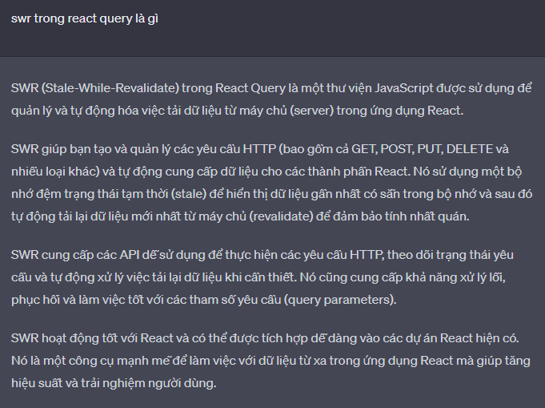

## Đây là Docs tự research:

- ❓ Đây là câu hỏi trong bài này:

- ❓ Câu hỏi: Anh ơi, em thấy trong `useQuery()` đã có sẵn hàm `refetch()`, em cũng hay dùng hàm này mỗi khi cần refetch data sau khi `mutate`. Vậy hàm `refetch()` này khác thế nào với 2 cái `queryClient.setQueyData()` và `queryClient.invalidateQueries()` là gì ấy anh ?

- ✅ Trả lời: `refetch` => Gọi 1 cái query instance trong component. `invalidateQueries` => Gọi lại 1 hoặc nhiều query, có thể dùng cho các component khác cũng được. `setQueryData` => Cập nhật data mới (không fetch lại API)

## Ôn lại bài cũ: 💥💥💥

## Trong react query trong đó có queryKey. Trong queryKey có 2 tham số, 2 tham số đó là gì ?

- Trong React Query, `queryKey` là một mảng gồm các tham số để xác định một truy vấn dữ liệu cụ thể. Mỗi phần tử trong mảng `queryKey` đại diện cho một phần quan trọng trong việc xác định truy vấn.

- Thường thì `queryKey` được định nghĩa với cấu trúc `[type, ...params]`, trong đó:

  - `type`: Là một chuỗi (string) đại diện cho loại dữ liệu bạn muốn truy vấn, ví dụ như "user", "todos", "posts",...
  - `params`: Là các tham số bổ sung khác (nếu có) để xác định truy vấn dữ liệu một cách cụ thể. Các tham số này thường được sử dụng để xác định một đối tượng hoặc một giá trị duy nhất liên quan đến truy vấn.

- Ví dụ, nếu bạn muốn truy vấn dữ liệu của một người dùng cụ thể với `userId` là 1, thì `queryKey` có thể được định nghĩa là `['user', 1]`. Trong đó, `'user'` là loại dữ liệu `"user"`, và 1 là `userId`.

- Tùy thuộc vào cách bạn định nghĩa truy vấn và cấu trúc dữ liệu của ứng dụng, số lượng và ý nghĩa của các tham số trong `queryKey` có thể khác nhau. Bạn có thể tuỳ chỉnh `queryKey` để phù hợp với nhu cầu của truy vấn dữ liệu của mình.

## ❌❌ Tham số đầu tiên trong `queryKey` có phải là nó tiếp nối với `router` trên `server` không. Ví dụ tôi có `localhost://blog/post`, trong link đó có `/post`, thì đó có phải là `type` của `queryKey` không ?

- Không, tham số đầu tiên trong `queryKey` không phải là tiếp nối với `router` trên `server`. Nó chỉ đơn giản là một chuỗi (string) đại diện cho loại dữ liệu bạn muốn truy vấn.

- Trong trường hợp của bạn, nếu bạn có một trang web `localhost://blog/post` và bạn muốn truy vấn dữ liệu về bài viết (`post`), bạn có thể sử dụng `'post'` làm tham số đầu tiên trong `queryKey` để xác định loại dữ liệu là bài viết.

- Ví dụ: `queryKey: ['post', ...]`

- Việc tiếp nối với `router` trên `server` thường được xử lý bên phía `server` và không liên quan trực tiếp đến `queryKey` trong React Query. `queryKey` chỉ đơn giản là một phần trong việc xác định truy vấn dữ liệu mà React Query sẽ quản lý và điều khiển.

## Vậy thì tham số đầu tiên trong `queryKey` phụ thuộc vào cái gì, nó đặt tên `type` cho tham số đầu tiên nó phụ thuộc vào đâu, hay là mình đặt tên gì cũng được ?

- Tham số đầu tiên trong `queryKey` không phụ thuộc vào bất kỳ yếu tố cụ thể nào và bạn có thể đặt tên cho nó theo ý muốn. Nó không có quy tắc cứng nhắc về cách đặt tên, và bạn có thể sử dụng bất kỳ chuỗi nào làm giá trị cho tham số đầu tiên.

- Tuy nhiên, để giữ cho tên tham số đầu tiên trong `queryKey` dễ hiểu và dễ quản lý, bạn có thể chọn các giá trị có liên quan đến loại dữ liệu bạn đang truy vấn. Ví dụ, nếu bạn đang truy vấn dữ liệu về bài viết, bạn có thể đặt tên tham số đầu tiên là `'post'`. Tuy nhiên, bạn cũng có thể sử dụng bất kỳ tên nào phù hợp với dự án của mình, ví dụ như `'data'`, `'item'`, `'resource'`, vv.

## Việc đặt tên như thế thì khi nó lưu trong `cache` thì nó có `key` là `post` có phải không ?

- Không, khi dữ liệu được lưu trong cache, không phải là tên của tham số đầu tiên trong `queryKey` được sử dụng làm `key` trong `cache`. Trong React Query, các key trong cache được quản lý tự động và được tạo ra dựa trên các tham số của `queryKey`, không phụ thuộc vào giá trị của các tham số đó.

- Khi bạn thực hiện một truy vấn và sử dụng `queryKey` để định danh nó, React Query sẽ tạo một key duy nhất cho truy vấn đó trong cache. Key này sẽ dựa trên các giá trị của các tham số trong `queryKey` và được tạo ra theo quy tắc của React Query.

- Vì vậy, trong ví dụ của bạn với `queryKey: ['post', id]`, dữ liệu được lưu trong cache sẽ không có key là `'post'`, mà sẽ có một key duy nhất được tạo ra bởi React Query dựa trên giá trị của `id` và quy tắc của nó.

## Vậy `'post'` trong tham số đầu tiên trong queryKey được đặt để làm gì ? Nó không có tác dụng gì hả ?

- Trong `queryKey`, tham số đầu tiên (trong trường hợp của bạn là `'post'`) không có tác dụng trực tiếp trong việc quản lý cache hoặc định danh truy vấn. Nó chỉ là một giá trị bổ sung mà bạn có thể sử dụng để phân loại các loại truy vấn hoặc nhận biết mục đích của truy vấn đó.

- Ví dụ, nếu bạn có nhiều loại truy vấn trong ứng dụng của mình như `'post'`, `'user'`, `'comment'`, thì sử dụng giá trị đầu tiên trong `queryKey` là một cách để phân loại các truy vấn và làm cho code dễ đọc hơn. Tuy nhiên, React Query không sử dụng giá trị này trong quá trình quản lý cache hay tạo key cho cache.

- Do đó, nếu bạn chỉ có một loại truy vấn duy nhất và không cần phân loại các truy vấn, bạn có thể sử dụng một mảng `queryKey` chỉ với một tham số, ví dụ như `[id]`, và bỏ qua giá trị đầu tiên.

## ❌❌ Đặt tên cho giá trị truy vấn là `'post'`, thì khi có một cái queryKey khác cũng có tham số đầu tiên là `'post'` lúc này 2 cái truy vấn cùng tên sẽ gọi lại cùng nhau đúng không ?

- Trong React Query, các truy vấn không chỉ phụ thuộc vào giá trị của tham số đầu tiên trong `queryKey` để xác định xem chúng có cùng một truy vấn hay không. Thay vào đó, React Query sử dụng cơ chế định danh truy vấn dựa trên toàn bộ `queryKey`.

- Khi bạn khởi tạo một truy vấn mới với một `queryKey` cụ thể, React Query sẽ tạo ra một key duy nhất cho truy vấn đó bằng cách kết hợp các giá trị trong `queryKey`. Do đó, ngay cả khi có hai `queryKey` với cùng giá trị `'post'` trong tham số đầu tiên, nhưng có các giá trị khác trong các tham số khác, chúng sẽ được xem là hai truy vấn riêng biệt và không gọi lại cùng nhau.

- Ví dụ:

```jsx
const queryKey1 = ['post', 1]
const queryKey2 = ['post', 2]

// Hai queryKey khác nhau, không gọi lại cùng nhau
queryClient.fetchQuery(queryKey1)
queryClient.fetchQuery(queryKey2)
```

- Do đó, khi đặt tên cho giá trị trong `queryKey`, bạn có thể sử dụng cùng một giá trị cho tham số đầu tiên nếu nó hợp lý với bản thiết kế của ứng dụng của bạn. Tuy nhiên, hãy chắc chắn rằng các giá trị khác trong `queryKey` khác nhau để các truy vấn không gọi lại nhau nhầm lẫn.

## ❌❌ Vậy thì tham số thứ 2 là `id`, nó là duy nhất. Mà nó dựa vào link `API` từ `server` để nó lấy dữ liệu hay sao ?

- Tham số thứ hai trong `queryKey` thường là một giá trị duy nhất như `ID`, và nó thường được sử dụng để định danh một mục dữ liệu cụ thể trong hệ thống hoặc API từ server.

- Khi bạn thực hiện một truy vấn với `queryKey` chứa một giá trị `ID`, ví dụ như `['post', 1]`, React Query sử dụng giá trị `ID` này để xác định dữ liệu cần truy vấn từ server. Cách xử lý chi tiết sẽ phụ thuộc vào cách bạn cấu hình truy vấn và tương tác với API của mình.

- Thông thường, bạn sẽ sử dụng giá trị `ID` để chỉ định một mục dữ liệu cụ thể, ví dụ như lấy thông tin một bài viết theo `ID`, hoặc lấy chi tiết một người dùng dựa trên `ID` của họ. Truyền giá trị `ID` này trong `queryKey` cho truy vấn sẽ giúp React Query nhận biết rõ rằng truy vấn đó tương ứng với một dữ liệu cụ thể và cần được cập nhật hoặc làm mới khi có thay đổi.

- Tuy nhiên, cách mà dữ liệu được truy vấn từ server dựa trên `queryKey` và giá trị `ID` sẽ phụ thuộc vào cách bạn triển khai API của mình. Bạn cần xác định và xử lý logic phù hợp trong hàm truy vấn (`queryFn`) để gửi yêu cầu đến API và lấy dữ liệu tương ứng với giá trị `ID` từ server.

## Bạn có thể tìm hiểu thêm về cách sử dụng `invalidateQueries` và các tùy chọn khác `invalidateQueries`:

- Tất nhiên! Cùng tìm hiểu thêm về cách sử dụng `invalidateQueries` và các tùy chọn trong React Query.

- Phương thức `invalidateQueries` được sử dụng để làm mới các truy vấn trong React Query. Nó có thể được sử dụng với các tùy chọn để kiểm soát cách truy vấn được làm mới.

- Cú pháp:

```jsx
queryClient.invalidateQueries(key, options)
```

- Trong đó:

  - `key` là key hoặc một mảng các key của các truy vấn cần làm mới.
  - `options` là một đối tượng (object) tùy chọn (không bắt buộc) để kiểm soát hành vi làm mới.

- Các tùy chọn phổ biến khi sử dụng `invalidateQueries` bao gồm:

  1. `exact`: Mặc định là `false`. Khi được đặt thành `true`, chỉ có các truy vấn có key chính xác trùng khớp với key mới sẽ được làm mới, các truy vấn con hoặc truy vấn khác không được làm mới.

  2. `refetchActive`: Mặc định là `false`. Khi được đặt thành `true`, các truy vấn đang trong quá trình `fetching` sẽ được hủy và làm mới.

  3. `refetchInactive`: Mặc định là `false`. Khi được đặt thành `true`, các truy vấn không hoạt động (`inactive`) sẽ được làm mới. Một truy vấn được coi là không hoạt động nếu không có listeners nào đang lắng nghe sự thay đổi trong nó.

  4. `throwOnError`: Mặc định là `false`. Khi được đặt thành `true`, nếu có lỗi xảy ra trong quá trình làm mới truy vấn, nó sẽ ném ra lỗi để được xử lý bên ngoài.

- Ví dụ sử dụng `invalidateQueries` với các tùy chọn:

```jsx
import { useQueryClient } from 'react-query';

const TodoList = () => {
  const queryClient = useQueryClient();

  const handleDeleteTodo = async (todoId) => {
    // Gọi API để xóa todo
    await deleteTodoAPI(todoId);

    // Làm mới truy vấn 'todos' và chỉ làm mới truy vấn chính xác
    queryClient.invalidateQueries('todos', {
      exact: true
    });
  };

  return (
    // ...
  );
};
```

- Trong ví dụ trên, chúng ta sử dụng `invalidateQueries` để làm mới truy vấn `'todos'` và chỉ làm mới truy vấn có key chính xác là `'todos'`. Các truy vấn con hoặc truy vấn khác không được làm mới.

- Đây là một ví dụ cơ bản về cách sử dụng `invalidateQueries` và các tùy chọn trong React Query. Bạn có thể tìm hiểu thêm về các tùy chọn khác và các khả năng linh hoạt khác của React Query trong tài liệu chính thức của nó.

## Hãy giải thích khái niệm về `invalidateQueries` và cách triển khai sử dụng nó trong code như thế nào ?

- Trong React Query, khái niệm `"invalidateQueries"` được sử dụng để làm mới (invalidate) các truy vấn đã được lưu trữ trong bộ nhớ cache. Khi một truy vấn được làm mới, React Query sẽ tự động gửi một yêu cầu mới để lấy dữ liệu mới nhất từ nguồn dữ liệu.

- Cách sử dụng `"invalidateQueries"` là thông qua phương thức `"invalidateQueries"` của đối tượng `queryClient`, mà bạn có thể lấy bằng cách sử dụng hook `"useQueryClient"` từ thư viện react-query. Ví dụ:

```jsx
import { useQueryClient } from 'react-query'

const TodoList = () => {
  const queryClient = useQueryClient()

  const handleDeleteTodo = async (todoId) => {
    // Gọi API để xóa todo

    // Làm mới truy vấn 'todos'
    queryClient.invalidateQueries('todos')
  }

  // ...
}
```

- Trong ví dụ trên, chúng ta sử dụng `"invalidateQueries"` để làm mới truy vấn có key là `'todos'`. Khi phương thức này được gọi, React Query sẽ tự động xóa truy vấn `'todos'` khỏi bộ nhớ cache và gửi một yêu cầu mới để lấy dữ liệu mới nhất từ nguồn dữ liệu.

- Ngoài ra, `"invalidateQueries"` cũng hỗ trợ các tùy chọn để kiểm soát cách làm mới truy vấn, như:

  - `exact`: Xác định liệu chỉ có truy vấn có key chính xác trùng khớp với key được chỉ định mới sẽ được làm mới hay không.
  - `refetchActive`: Xác định liệu các truy vấn đang trong quá trình `fetching` sẽ được hủy và làm mới hay không.
  - `refetchInactive`: Xác định liệu các truy vấn không hoạt động (inactive) sẽ được làm mới hay không.
  - `throwOnError`: Xác định liệu nếu có lỗi xảy ra trong quá trình làm mới truy vấn, có ném ra lỗi để được xử lý bên ngoài hay không.

- Các tùy chọn này có thể được truyền vào phương thức `"invalidateQueries"` để điều chỉnh hành vi làm mới truy vấn.

- `InvalidateQueries` là một công cụ mạnh mẽ trong React Query, cho phép làm mới các truy vấn một cách linh hoạt và dễ dàng khi cần thiết, đảm bảo rằng dữ liệu trong cache của chúng ta luôn được cập nhật và đồng bộ với nguồn dữ liệu.

## ❓❓ Còn khái niệm nào khác với khái niệm trên không ?

- Khái niệm khác liên quan đến `"invalidateQueries"` trong React Query là `"refetchQueries"`. `"refetchQueries"` cho phép làm mới một danh sách các truy vấn cụ thể sau khi một truy vấn hoặc `mutation` đã được thực hiện thành công.

- Khi sử dụng `"refetchQueries"`, bạn có thể chỉ định danh sách các truy vấn cần làm mới bằng cách sử dụng key của từng truy vấn. Khi một `mutation` hoặc một truy vấn thành công (với tùy chọn "onSuccess"), React Query sẽ tự động làm mới các truy vấn được chỉ định trong `"refetchQueries"`.

- Ví dụ:

```jsx
const createPost = async (newPost) => {
  // Gửi yêu cầu để tạo bài viết mới

  // Làm mới các truy vấn liên quan sau khi tạo bài viết thành công
  queryClient.refetchQueries(['posts', 'userPosts'])
}
```

- Trong ví dụ trên, sau khi tạo bài viết mới thành công, chúng ta sử dụng `"refetchQueries"` để làm mới hai truy vấn có keys là `'posts'` và `'userPosts'`. Các truy vấn này sẽ được gửi lại để lấy dữ liệu mới nhất từ nguồn dữ liệu.

- Qua đó, `"refetchQueries"` cung cấp một cách linh hoạt hơn để làm mới nhiều truy vấn cùng một lúc sau khi có sự thay đổi trong dữ liệu.

## ❌❌ Giải thích ý này trong đoạn trên: - Trong ví dụ trên, sau khi tạo bài viết mới thành công, chúng ta sử dụng `"refetchQueries"` để làm mới hai truy vấn có keys là `'posts'` và `'userPosts'`. Các truy vấn này sẽ được gửi lại để lấy dữ liệu mới nhất từ nguồn dữ liệu ? Có nghĩa là nó lấy dữ liệu mới nhất để nó lưu trong `cache` hay là nó `render` lên giao diện người dùng ?

- Khi sử dụng `"refetchQueries"` trong React Query, nó sẽ gửi lại các truy vấn được chỉ định trong danh sách `refetchQueries` để lấy dữ liệu mới nhất từ nguồn dữ liệu trên server. Sau đó, dữ liệu mới được nhận sẽ được lưu trong cache của React Query và có thể được sử dụng để render lại giao diện người dùng.

- Ví dụ, khi chúng ta tạo một bài viết mới thành công, chúng ta có thể sử dụng `"refetchQueries"` để gửi lại các truy vấn `'posts'` và `'userPosts'` để lấy danh sách bài viết mới nhất. Khi các truy vấn này thành công, dữ liệu mới sẽ được lưu trong cache của React Query. Sau đó, chúng ta có thể sử dụng dữ liệu mới này để cập nhật giao diện người dùng, hiển thị danh sách bài viết mới nhất và các bài viết của người dùng tương ứng.

- Tóm lại, `"refetchQueries"` giúp chúng ta làm mới các truy vấn và cập nhật dữ liệu mới nhất từ server, từ đó lưu vào cache và sử dụng để render lại giao diện người dùng.

## Theo trình tự là nó lưu vào trong cache của server trước rồi nó mới render lên giao diện người dùng phải không ?

- Không, trong trường hợp của React Query, dữ liệu không được lưu trực tiếp trong cache của `server`. React Query sử dụng một cache riêng để lưu trữ dữ liệu trên phía `client`, được quản lý bởi thư viện React Query.

- Khi một truy vấn được gửi từ React Query, dữ liệu trả về từ `server` sẽ được lưu trữ trong cache của React Query trên phía `client`. Sau đó, dữ liệu này có thể được truy xuất và sử dụng mà không cần gửi yêu cầu lại đến `server`. Khi có sự thay đổi trong dữ liệu hoặc khi chúng ta yêu cầu làm mới dữ liệu, React Query sẽ gửi yêu cầu tới `server` để lấy dữ liệu mới nhất và cập nhật lại cache.

- Sau khi dữ liệu đã được lưu trữ trong cache của React Query, chúng ta có thể sử dụng nó để render lại giao diện người dùng. Khi có thay đổi trong cache hoặc khi chúng ta gửi yêu cầu làm mới dữ liệu, React Query sẽ tự động cập nhật giao diện người dùng dựa trên dữ liệu mới trong cache mà không cần gửi yêu cầu mới đến `server`.

- Vì vậy, trong quá trình sử dụng React Query, dữ liệu được lưu trữ và quản lý trong cache của React Query trên phía `client` và dùng để render giao diện người dùng mà không tác động trực tiếp vào cache của `server`.

## ❓❓ `invalidateQueries` và `refetchQueries` điểm giống nhau của nó là gì ?

- Cả hai phương thức `invalidateQueries` và `refetchQueries` trong React Query đều liên quan đến việc cập nhật dữ liệu của các truy vấn.

- Điểm giống nhau của hai phương thức này là cả hai đều có thể được sử dụng để cập nhật dữ liệu của các truy vấn. Khi sử dụng cả `invalidateQueries` và `refetchQueries`, React Query sẽ gửi các yêu cầu mới để lấy dữ liệu mới nhất từ máy chủ và cập nhật lại kết quả truy vấn.

- Tuy nhiên, có một sự khác biệt quan trọng giữa hai phương thức này:

1. `invalidateQueries`: Phương thức này chỉ đánh dấu các truy vấn là không hợp lệ, nhưng không gửi yêu cầu lấy dữ liệu mới từ máy chủ. Nó thông báo cho React Query biết rằng dữ liệu của các truy vấn này đã không còn hợp lệ và cần được làm mới. React Query sẽ tự động gửi yêu cầu mới để lấy dữ liệu mới khi cần thiết, ví dụ như khi truy cập lại trang hoặc khi sử dụng các phương thức như `refetch` hoặc `useQueryClient`.

2. `refetchQueries`: Phương thức này gửi yêu cầu lấy dữ liệu mới từ máy chủ cho các truy vấn đã được chỉ định. Bằng cách sử dụng `refetchQueries`, bạn có thể tường minh yêu cầu React Query gửi yêu cầu mới và cập nhật dữ liệu của các truy vấn đã được chỉ định ngay lập tức.

- Tóm lại, điểm giống nhau của `invalidateQueries` và `refetchQueries` là cả hai đều liên quan đến việc cập nhật dữ liệu của các truy vấn, nhưng cách thức và quyền kiểm soát cập nhật dữ liệu của chúng có sự khác biệt.

## ❓❓ `invalidateQueries` và `refetchQueries` điểm khác nhau của nó là gì ?

- Điểm khác nhau chính giữa `invalidateQueries` và `refetchQueries` trong React Query là:

1. `invalidateQueries`: Phương thức `invalidateQueries` được sử dụng để đánh dấu các truy vấn là không hợp lệ. Khi bạn gọi phương thức này, React Query sẽ ghi nhận rằng dữ liệu của các truy vấn đã không còn hợp lệ và cần được làm mới. Tuy nhiên, phương thức này không gửi yêu cầu lấy dữ liệu mới từ máy chủ ngay lập tức. Thay vào đó, React Query sẽ tự động gửi yêu cầu lấy dữ liệu mới khi cần thiết, chẳng hạn khi truy cập lại trang hoặc khi sử dụng các phương thức như `refetch` hoặc `useQueryClient`.

2. `refetchQueries`: Phương thức `refetchQueries` được sử dụng để gửi yêu cầu lấy dữ liệu mới từ máy chủ cho các truy vấn đã được chỉ định. Khi bạn gọi phương thức này và chỉ định các truy vấn cần làm mới, React Query sẽ tức thì gửi yêu cầu mới và cập nhật dữ liệu của các truy vấn đó.

- Vậy điểm khác nhau chính là `invalidateQueries` chỉ đánh dấu truy vấn là không hợp lệ, trong khi `refetchQueries` gửi yêu cầu lấy dữ liệu mới ngay lập tức cho các truy vấn được chỉ định.

## ❓❓ Còn cái nào khác với khái niệm trên không ?

- Một khái niệm khác liên quan đến `"invalidateQueries"` trong React Query là `"resetQueries"`. `"resetQueries"` được sử dụng để đặt lại (reset) dữ liệu của một hay nhiều truy vấn về trạng thái ban đầu.

- Khi sử dụng `"resetQueries"`, bạn có thể chỉ định danh sách các truy vấn cần đặt lại bằng cách sử dụng key của từng truy vấn. Khi một hành động hoặc một sự kiện xảy ra và bạn muốn đặt lại dữ liệu các truy vấn để bắt đầu lại từ trạng thái ban đầu, bạn có thể sử dụng `"resetQueries"` để làm điều đó.

- Ví dụ:

```jsx
const handleLogout = async () => {
  // Thực hiện đăng xuất

  // Đặt lại dữ liệu các truy vấn liên quan về trạng thái ban đầu
  queryClient.resetQueries(['user', 'posts'])
}
```

- Trong ví dụ trên, khi người dùng thực hiện đăng xuất (Log out), chúng ta sử dụng `"resetQueries"` để đặt lại dữ liệu của hai truy vấn có keys là `'user'` và `'posts'`, để bắt đầu lại từ trạng thái ban đầu. Điều này có thể hữu ích khi cần đảm bảo rằng dữ liệu hiển thị sau khi đăng xuất là dữ liệu mới nhất và không bị lưu lại từ phiên đăng nhập trước.

- Tổng quan, `"resetQueries"` là một cách để đặt lại dữ liệu của các truy vấn về trạng thái ban đầu, trong khi `"invalidateQueries"` là một cách để đánh dấu các truy vấn là không hợp lệ và chuẩn bị cho việc làm mới chúng. Cả hai đều giúp quản lý và điều khiển dữ liệu trong React Query.

## Biết được cách sử dụng Invalidate Query (`invalidateQueries`) trong React Query:

- Trong React Query, `invalidateQueries` là một phương thức được cung cấp bởi `useQueryClient` để làm mới (invalidate) các truy vấn đã được lưu trong bộ nhớ cache. Khi chúng ta gọi phương thức này, React Query sẽ xóa kết quả truy vấn trong cache và kích hoạt lại việc truy vấn dữ liệu mới từ nguồn dữ liệu (ví dụ: từ API).

- Dưới đây là cách sử dụng phương thức `invalidateQueries` trong React Query:

1. Đầu tiên, chúng ta cần lấy instance của `queryClient` bằng cách sử dụng `useQueryClient` trong component:

```jsx
import { useQueryClient } from 'react-query'

const MyComponent = () => {
  const queryClient = useQueryClient()

  // ...
}
```

2. Sau đó, khi muốn làm mới một hoặc nhiều truy vấn, chúng ta gọi phương thức `invalidateQueries` trên `queryClient`:

```jsx
queryClient.invalidateQueries('todos')
```

- Trong ví dụ trên, chúng ta gọi `invalidateQueries('todos')` để làm mới các truy vấn có key là `'todos'`. Điều này sẽ xóa kết quả truy vấn trong cache và kích hoạt lại việc truy vấn dữ liệu mới cho các truy vấn có key là `'todos'`.

- Ngoài ra, chúng ta có thể truyền một mảng các key để làm mới nhiều truy vấn cùng một lúc:

```jsx
queryClient.invalidateQueries(['todos', 'user', 'posts'])
```

- Trong ví dụ trên, chúng ta làm mới các truy vấn có key là `'todos'`, `'user'` và `'posts'`. Tất cả các truy vấn này sẽ được xóa khỏi cache và truy vấn lại từ nguồn dữ liệu.

- `invalidateQueries` cũng hỗ trợ một số tùy chọn để điều chỉnh cách làm mới truy vấn, như `exact` để chỉ làm mới truy vấn chính xác bằng key hoặc `refetchActive` để làm mới các truy vấn đang được hoạt động. Để biết thêm chi tiết, bạn có thể tham khảo tài liệu chính thức của React Query.

## Hướng dẫn và ví dụ về việc sử dụng React Query, bao gồm cả việc sử dụng phương thức `invalidateQueries` ?

- Để sử dụng phương thức `invalidateQueries` trong React Query, bạn cần làm như sau:

1. Đầu tiên, đảm bảo rằng bạn đã cài đặt React Query và đã import các hàm cần thiết từ thư viện:

```jsx
import { useQueryClient } from 'react-query'
```

2. Trong component của bạn, sử dụng hook `useQueryClient` để lấy một instance của `QueryClient`:

```jsx
const queryClient = useQueryClient()
```

3. Bây giờ bạn có thể sử dụng phương thức `invalidateQueries` để làm mới các truy vấn trong `QueryClient`. Phương thức này nhận vào một key hoặc một mảng các key để chỉ định các truy vấn cần làm mới:

```jsx
queryClient.invalidateQueries('todos') // Làm mới truy vấn có key là 'todos'
queryClient.invalidateQueries(['user', userId]) // Làm mới truy vấn có key là ['user', userId]
queryClient.invalidateQueries() // Làm mới tất cả các truy vấn trong QueryClient
```

- Ví dụ về việc sử dụng `invalidateQueries`:

```jsx
import { useQuery, useQueryClient } from 'react-query'

const TodoList = () => {
  const queryClient = useQueryClient()

  const handleDeleteTodo = async (todoId) => {
    // Gọi API để xóa todo
    await deleteTodoAPI(todoId)

    // Làm mới truy vấn 'todos' sau khi xóa
    queryClient.invalidateQueries('todos')
  }

  return (
    <div>
      {/* Hiển thị danh sách todo */}
      {todos.map((todo) => (
        <div key={todo.id}>
          <span>{todo.title}</span>
          <button onClick={() => handleDeleteTodo(todo.id)}>Xóa</button>
        </div>
      ))}
    </div>
  )
}
```

- Trong ví dụ trên, khi người dùng nhấn vào nút "Xóa" để xóa một todo, chúng ta gọi API để thực hiện xóa todo đó. Sau khi xóa thành công, chúng ta sử dụng `invalidateQueries` để làm mới truy vấn 'todos', từ đó đảm bảo rằng danh sách todos được cập nhật mới nhất.

## Đây là một ví dụ khác về invalidateQueries trong react query:

- Trong React Query, `invalidateQueries` là một phương thức cho phép ta xóa bỏ cache của một hoặc nhiều truy vấn (queries) đã được lưu trữ. Điều này cho phép ta thực hiện lại truy vấn đó và cập nhật lại dữ liệu mới nhất.

- Ví dụ, giả sử ta có một truy vấn `getUserData` để lấy dữ liệu người dùng từ API như sau:

```jsx
import { useQuery } from 'react-query'

function ProfilePage({ userId }) {
  const { data, isLoading } = useQuery(['userData', userId], () =>
    fetch(`/api/users/${userId}`).then((res) => res.json())
  )

  if (isLoading) {
    return <div>Loading...</div>
  }

  return <div>{data.name}</div>
}
```

- Đoạn code trên là một ví dụ về việc sử dụng hook `useQuery` trong React Query để lấy dữ liệu người dùng từ một API.

  - Đầu tiên, chúng ta sử dụng hook `useQuery` từ React Query và truyền vào hai tham số: `key` và một hàm (`function`) callback.
  - Trong đó, `key` được định nghĩa là một mảng `['userData', userId]`, đại diện cho truy vấn `"userData"` với `userId` là tham số phụ thuộc. Khi giá trị `userId` thay đổi, truy vấn sẽ được tự động thực hiện lại.
  - Hàm callback được cung cấp để thực hiện truy vấn thực tế. Trong trường hợp này, chúng ta gửi một yêu cầu `fetch` đến đường dẫn `/api/users/${userId}` để lấy dữ liệu người dùng từ server. Sau đó, chúng ta sử dụng phương thức `.json()` để chuyển đổi phản hồi từ server sang dữ liệu JSON.
  - Khi truy vấn đang được thực hiện, biến `isLoading` sẽ là `true`, và chúng ta có thể hiển thị thông báo `"Loading..."` trong giao diện người dùng để cho người dùng biết rằng dữ liệu đang được tải.
  - Khi truy vấn hoàn thành và có dữ liệu, biến `data` sẽ chứa kết quả trả về từ truy vấn. Trong ví dụ này, chúng ta hiển thị tên người dùng trong một thành phần `<div>`.
  - Nếu có lỗi xảy ra trong quá trình thực hiện truy vấn, React Query sẽ tự động xử lý lỗi và thông báo lỗi cho chúng ta. Tuy nhiên, trong ví dụ này, chúng ta không xử lý trường hợp lỗi mà chỉ đơn giản hiển thị thông báo `"Loading..."` khi đang tải dữ liệu.
  - Toàn bộ giao diện của trang sẽ được cập nhật tự động khi dữ liệu thay đổi hoặc khi có lỗi xảy ra trong truy vấn.

- Ở đây, ta sử dụng `useQuery` để lấy dữ liệu về người dùng với `userId` được truyền vào. Tuy nhiên, nếu người dùng thực hiện một hành động như cập nhật thông tin cá nhân, ta muốn cập nhật lại dữ liệu người dùng mới nhất. Để làm điều này, ta có thể sử dụng `invalidateQueries` như sau:

```jsx
import { useQueryClient } from 'react-query'

function ProfilePage({ userId }) {
  const queryClient = useQueryClient()

  const { data, isLoading } = useQuery(['userData', userId], () =>
    fetch(`/api/users/${userId}`).then((res) => res.json())
  )

  const handleUpdateProfile = () => {
    // Gọi API để cập nhật thông tin cá nhân của người dùng
    // Sau đó, ta sẽ gọi phương thức invalidateQueries để xóa cache của truy vấn "userData"
    queryClient.invalidateQueries('userData')
  }

  if (isLoading) {
    return <div>Loading...</div>
  }

  return (
    <div>
      <div>{data.name}</div>
      <button onClick={handleUpdateProfile}>Update Profile</button>
    </div>
  )
}
```

- Trong đoạn code trên, chúng ta sử dụng hook `useQueryClient` từ React Query để lấy một instance của `QueryClient` từ React Query context. `QueryClient` là một đối tượng quản lý trạng thái và tương tác với các truy vấn được tạo bởi React Query.

  - Chúng ta tạo một biến `queryClient` bằng cách gọi `useQueryClient()`, và sau đó sử dụng biến này để truy cập các phương thức và thuộc tính của `QueryClient`.

  - Tiếp theo, chúng ta sử dụng hook `useQuery` để thực hiện truy vấn `"userData"` và lấy dữ liệu người dùng từ API. Kết quả truy vấn được lưu trữ trong biến `data`, và biến `isLoading` xác định xem truy vấn đang được thực hiện hay không.

  - Chúng ta định nghĩa một hàm `handleUpdateProfile` để xử lý sự kiện khi người dùng bấm vào nút `"Update Profile"`. Trong hàm này, chúng ta có thể gọi API để cập nhật thông tin cá nhân của người dùng.

  - Sau khi cập nhật thành công, chúng ta sử dụng phương thức `invalidateQueries` của `queryClient` để xóa cache của truy vấn `"userData"`. Điều này đảm bảo rằng khi người dùng quay lại trang người dùng, truy vấn sẽ được thực hiện lại để lấy dữ liệu mới nhất từ API thay vì sử dụng dữ liệu từ cache.

  - Nếu trạng thái `isLoading` là `true`, chúng ta hiển thị thông báo `"Loading..."` trong giao diện người dùng để cho người dùng biết rằng dữ liệu đang được tải.

  - Nếu không có lỗi xảy ra và dữ liệu đã được tải thành công, chúng ta hiển thị tên người dùng trong một thành phần `<div>`.

  - Nút `"Update Profile"` được gắn một sự kiện onClick để gọi hàm `handleUpdateProfile` khi được bấm.

- ✅✅ Ở đây, ta sử dụng `useQueryClient` để lấy một instance của `QueryClient`, sau đó ta gọi `invalidateQueries('userData')` để xóa cache của truy vấn `userData`. Khi người dùng click vào nút `"Update Profile"`, ta sẽ gọi hàm `handleUpdateProfile` và cập nhật lại dữ liệu người dùng mới nhất.

## ❌❌ invalidateQueries('userData'), nó xoá cache có tên là `userData` hả ?

- Đúng, `invalidateQueries('userData')` là phương thức để xoá cache của truy vấn có tên là `'userData'`. Khi chúng ta gọi `queryClient.invalidateQueries('userData')`, nó sẽ xóa cache của truy vấn `'userData'`, đồng nghĩa với việc loại bỏ dữ liệu đã lưu trữ trước đó trong cache cho truy vấn đó.

- Sau khi cache bị xoá, khi chúng ta gọi lại truy vấn `'userData'`, React Query sẽ thực hiện truy vấn mới và tải dữ liệu mới nhất từ nguồn dữ liệu (ví dụ: API) thay vì trả về dữ liệu từ cache. Điều này đảm bảo rằng chúng ta luôn có dữ liệu cập nhật nhất từ nguồn dữ liệu.

## ❌❌ Khi chúng ta xoá cache và quay lại trang trước đó là lúc đó ta có dữ liệu mới nhất. Dữ liệu mới nhất đó ta lấy từ đâu ? API nó tự cập nhật lại dữ liệu hả ?

- Khi chúng ta xoá cache và quay lại trang trước đó, dữ liệu mới nhất được lấy từ nguồn dữ liệu, ví dụ như API. Khi chúng ta gọi lại truy vấn sau khi xoá cache, React Query sẽ thực hiện một cuộc gọi đến API để lấy dữ liệu mới nhất từ nguồn dữ liệu.

- Quá trình cập nhật dữ liệu mới nhất từ API có thể được thực hiện một trong hai cách:

  1. `Tự động cập nhật`: Trong một số trường hợp, API có thể tự động cập nhật dữ liệu mới và trả về cho chúng ta mỗi khi có sự thay đổi. Điều này có thể xảy ra khi có sự thay đổi dữ liệu từ các hoạt động khác (ví dụ: thêm, sửa, xoá), (`POST`, `PUT`, `DELETE`) hoặc khi có cập nhật dữ liệu định kỳ. Khi chúng ta gọi lại truy vấn, React Query sẽ thực hiện cuộc gọi đến API và nhận dữ liệu mới nhất.

  2. `Thực hiện gọi API cập nhật`: Trong một số trường hợp, chúng ta có thể thực hiện gọi API để cập nhật dữ liệu mới. Điều này có thể xảy ra khi người dùng thực hiện một hành động như nhấn nút cập nhật hoặc gửi một yêu cầu cập nhật thông qua giao diện người dùng. Khi chúng ta thực hiện gọi API cập nhật, React Query sẽ thực hiện cuộc gọi đến API và sau đó xoá cache của truy vấn để đảm bảo lấy dữ liệu mới nhất từ nguồn dữ liệu.

- Tóm lại, khi chúng ta xoá cache và gọi lại truy vấn, React Query sẽ thực hiện cuộc gọi đến API để lấy dữ liệu mới nhất từ nguồn dữ liệu hoặc cập nhật dữ liệu thông qua gọi API cập nhật.

## ❌❌ React Query sẽ thực hiện cuộc gọi đến API để lấy dữ liệu mới nhất từ nguồn dữ liệu ? Có nghĩa là React Query nó tự động gọi hay sao ?

- Đúng, React Query có thể tự động thực hiện cuộc gọi đến API để lấy dữ liệu mới nhất từ nguồn dữ liệu. Khi chúng ta gọi lại truy vấn bằng cách sử dụng phương thức `queryClient.invalidateQueries()`, React Query sẽ tự động thực hiện một cuộc gọi đến API để lấy dữ liệu mới nhất.

- Tuy nhiên, việc tự động gọi API để lấy dữ liệu mới nhất phụ thuộc vào cấu hình của React Query và cách chúng ta định nghĩa truy vấn. React Query cung cấp các tùy chọn để điều chỉnh cách cuộc gọi API được thực hiện, bao gồm cách kiểm soát thời gian và tần suất của các cuộc gọi API. Chúng ta có thể định nghĩa thời gian mà một truy vấn được coi là `"stale"` (cũ) và cần được gọi lại, cũng như tần suất cập nhật dữ liệu.

- Với một cấu hình phù hợp, React Query có thể tự động gọi API để lấy dữ liệu mới nhất khi cần thiết, giúp chúng ta luôn có dữ liệu chính xác và đồng bộ với nguồn dữ liệu.

## ❌❌ React Query tự động gọi lại hay không thì nó còn phụ thuộc vào phương này `invalidateQueries()` hay sao ?

- React Query không tự động gọi lại các truy vấn một cách tự động sau khi chúng được `invalidate` bằng phương thức `invalidateQueries()`. Phương thức này chỉ đơn giản là xóa cache của các truy vấn đã được định nghĩa.

- Khi cache của một truy vấn bị xóa, React Query không tự động gọi lại truy vấn đó để lấy dữ liệu mới nhất từ nguồn dữ liệu. Thay vào đó, để lấy dữ liệu mới nhất, chúng ta cần phải sử dụng các phương thức khác như `refetch()` hoặc truy cập lại trang hoặc thành phần chứa truy vấn đó.

- Tuy nhiên, có thể sử dụng các tùy chọn và cấu hình của React Query để xác định cách các truy vấn được tự động gọi lại trong trường hợp cụ thể. Các tùy chọn như `staleTime`, `cacheTime`, `refetchOnMount`, `refetchOnWindowFocus`,... cho phép chúng ta điều chỉnh cách React Query xử lý các truy vấn và tự động gọi lại chúng khi cần thiết.

## Cập nhật data của query thông qua mutation trong React Query:

- Để cập nhật dữ liệu của một truy vấn thông qua mutation trong React Query, chúng ta có thể sử dụng phương thức `useMutation`. Phương thức này cho phép chúng ta định nghĩa các hành động mutation thêm, sửa, xoá (POST, PUT, DELETE) và cung cấp các tùy chọn để xử lý kết quả của mutation.

- Dưới đây là một ví dụ về cách sử dụng mutation để cập nhật dữ liệu:

```jsx
import { useMutation, useQueryClient } from 'react-query'

function UserProfile({ userId }) {
  const queryClient = useQueryClient()

  const updateUserMutation = useMutation(
    (updatedUserData) => {
      // Gọi API để cập nhật thông tin người dùng
      // Trả về dữ liệu mới sau khi cập nhật
      return fetch(`/api/users/${userId}`, {
        method: 'PUT',
        headers: {
          'Content-Type': 'application/json'
        },
        body: JSON.stringify(updatedUserData)
      }).then((response) => response.json())
    },
    {
      // Tùy chọn onSuccess sẽ được gọi khi mutation thành công
      onSuccess: (data) => {
        // Cập nhật cache của truy vấn 'userData' với dữ liệu mới
        queryClient.setQueryData(['userData', userId], data)
      }
    }
  )

  const handleUpdateProfile = () => {
    const updatedData = {
      // Dữ liệu cập nhật người dùng
    }

    updateUserMutation.mutate(updatedData)
  }

  // ...
}
```

- Trong ví dụ trên, chúng ta định nghĩa một mutation bằng cách sử dụng `useMutation`. Trong hàm callback của mutation, chúng ta gọi API để cập nhật thông tin người dùng và trả về dữ liệu mới sau khi cập nhật. Khi mutation thành công, chúng ta sử dụng `onSuccess` để cập nhật cache của truy vấn `'userData'` với dữ liệu mới. Sau đó, chúng ta gọi `mutate` để kích hoạt mutation với dữ liệu cập nhật.

- Lưu ý rằng `setQueryData` được sử dụng để cập nhật cache của truy vấn `'userData'` trong `onSuccess` callback của mutation. Điều này đảm bảo rằng sau khi mutation thành công, dữ liệu trong truy vấn `'userData'` sẽ được cập nhật và có thể hiển thị dữ liệu mới trong UI.

## Phương thức setQueryData ở đâu mà có ? Nó có sẵn trong React Query hay sao ? Hãy giải thích ?

- Trong React Query, phương thức `setQueryData` không tồn tại. Thay vào đó, chúng ta sử dụng phương thức `queryClient.setQueryData` để cập nhật dữ liệu trong cache. Lưu ý là phải viết đúng cú pháp!!

- Phương thức `setQueryData` là một phương thức của đối tượng `queryClient` được trả về khi chúng ta sử dụng `useQueryClient` hook để truy cập vào instance của `queryClient` trong React component.

- Dưới đây là một ví dụ cụ thể về cách sử dụng `setQueryData` để cập nhật cache của truy vấn `'userData'` trong trường hợp mutation thành công:

```jsx
import { useMutation, useQueryClient } from 'react-query'

function UserProfile({ userId }) {
  const queryClient = useQueryClient()

  const updateUserMutation = useMutation((updatedUserData) => {
    // Gọi API để cập nhật thông tin người dùng
    // Trả về dữ liệu mới sau khi cập nhật
    return fetch(`/api/users/${userId}`, {
      method: 'PUT',
      headers: {
        'Content-Type': 'application/json'
      },
      body: JSON.stringify(updatedUserData)
    }).then((response) => response.json())
  })

  const handleUpdateProfile = async () => {
    const updatedData = {
      // Dữ liệu cập nhật người dùng
    }

    try {
      const data = await updateUserMutation.mutate(updatedData)

      // Cập nhật cache của truy vấn 'userData' với dữ liệu mới
      queryClient.setQueryData(['userData', userId], data)
    } catch (error) {
      // Xử lý lỗi khi mutation thất bại
    }
  }

  // ...
}
```

- Trong ví dụ trên, chúng ta sử dụng `setQueryData` để cập nhật cache của truy vấn `'userData'` trong `handleUpdateProfile` sau khi mutation thành công.

## Giải thích đoạn code trên:

- Đoạn code trên là một ví dụ về việc sử dụng `setQueryData` trong React Query để cập nhật cache của truy vấn sau khi một mutation thành công.

- Đầu tiên, chúng ta import các hook `useMutation` và `useQueryClient` từ thư viện React Query.

- Trong component `UserProfile`, chúng ta sử dụng `useQueryClient` để truy cập đối tượng `queryClient`, và gán nó vào biến `queryClient`.

- Tiếp theo, chúng ta sử dụng `useMutation` để khởi tạo một mutation `updateUserMutation`. Trong đó, chúng ta cung cấp một hàm callback làm tham số đầu tiên, đại diện cho việc gọi API để cập nhật thông tin người dùng.

- Trong hàm `handleUpdateProfile`, chúng ta thực hiện các bước sau:

  - Chuẩn bị dữ liệu cập nhật người dùng trong biến `updatedData`.
  - Sử dụng `updateUserMutation.mutate` để gọi mutation và đợi kết quả trả về.
  - Nếu mutation thành công và trả về dữ liệu mới, chúng ta sử dụng `setQueryData` để cập nhật cache của truy vấn `'userData'` với dữ liệu mới. Điều này đảm bảo rằng cache sẽ được cập nhật và component sẽ hiển thị dữ liệu mới nhất.
  - Nếu có lỗi xảy ra trong quá trình mutation, chúng ta có thể xử lý nó trong khối `catch` và thực hiện các hành động tương ứng.

- Trong phần render, chúng ta có thể hiển thị dữ liệu người dùng từ `data` và sử dụng `handleUpdateProfile` để gọi hàm cập nhật thông tin người dùng khi nhấn vào một nút.

- Tổng quan, đoạn code trên cho phép chúng ta sử dụng `setQueryData` để cập nhật cache của truy vấn sau khi mutation thành công, đảm bảo rằng component sẽ hiển thị dữ liệu mới nhất từ cache.

## Hiểu cách sử dụng tính năng prefetching của React Query:

- Tính năng prefetching trong React Query cho phép ta đoán trước và nạp trước dữ liệu từ các truy vấn để cung cấp trải nghiệm mượt mà và nhanh chóng cho người dùng. Khi ta prefetch dữ liệu, React Query sẽ tự động gọi các truy vấn và lưu kết quả vào bộ nhớ đệm trước khi chúng được yêu cầu.

- Để sử dụng tính năng prefetching, ta có thể sử dụng hàm `useQuery` trong React Query và truyền tham số `staleTime` cho truy vấn. Tham số `staleTime` xác định thời gian (theo milliseconds) mà dữ liệu trong bộ nhớ đệm được coi là còn hợp lệ (không cần phải gọi lại API). Mặc định, giá trị của `staleTime` là 0, tức là dữ liệu sẽ được coi là hết hạn và cần gọi lại API mỗi khi nó được yêu cầu.

- Ví dụ:

```jsx
import { useQuery } from 'react-query'

function UserProfile({ userId }) {
  const { data, isLoading } = useQuery(
    ['userData', userId],
    () => fetch(`/api/users/${userId}`).then((res) => res.json()),
    {
      // prefetching với staleTime là 5 giây
      staleTime: 5000
    }
  )

  // Các phần xử lý UI
  if (isLoading) {
    return <div>Loading...</div>
  }

  return (
    <div>
      <h2>User Profile</h2>
      <p>Name: {data.name}</p>
      <p>Email: {data.email}</p>
      <p>Location: {data.location}</p>
    </div>
  )
}
```

- Trong ví dụ trên, ta sử dụng `useQuery` để tạo một truy vấn có tên là `'userData'` với `userId` là tham số phụ thuộc. Ta cũng truyền tham số `staleTime` là 5000 milliseconds (5 giây). Điều này có nghĩa là khi dữ liệu trong bộ đệm của truy vấn `'userData'` còn hợp lệ (chưa quá thời gian staleTime), React Query sẽ sử dụng dữ liệu trong bộ đệm thay vì gọi lại API.

- Khi trang chứa component `UserProfile` được hiển thị, React Query sẽ tự động prefetch dữ liệu của truy vấn `'userData'` và lưu vào bộ đệm. Điều này giúp tăng tốc độ hiển thị dữ liệu khi người dùng truy cập vào trang, vì dữ liệu đã được sẵn sàng sử dụng ngay lập tức mà không cần phải chờ gọi API.

- Lưu ý rằng tính năng prefetching chỉ hoạt động khi ta sử dụng `useQuery` và không áp dụng cho các mutation hoặc các truy vấn khác như `useMutation` hoặc `usePaginatedQuery`.

## Giải thích code chi tiết:

- Trong đoạn code trên, ta sử dụng `useQuery` từ thư viện React Query để tạo một truy vấn dữ liệu người dùng (`'userData'`) với `userId` là tham số phụ thuộc.

- `{userId}`: Được truyền vào component `UserProfile` như một prop. Đây là id của người dùng được sử dụng để xác định truy vấn cụ thể cho mỗi người dùng.

- `['userData', userId]`: Đây là key của truy vấn, đại diện cho truy vấn `'userData'` cụ thể cho người dùng với `userId`. Key này cần được unique để React Query có thể quản lý và lưu trữ kết quả truy vấn.

- `() => fetch(/api/users/${userId}).then((res) => res.json())`: Đây là hàm callback được truyền vào `useQuery` và sẽ được gọi để thực hiện truy vấn dữ liệu người dùng từ API. Trong ví dụ này, ta sử dụng fetch để gửi yêu cầu GET đến địa chỉ `/api/users/${userId}` để lấy dữ liệu người dùng. Sau đó, ta trích xuất dữ liệu từ response bằng cách sử dụng `.json()`.

- `{ staleTime: 5000 }`: Đây là tùy chọn `staleTime` được truyền vào `useQuery` để thiết lập thời gian hết hạn của dữ liệu trong bộ đệm. Trong ví dụ này, `staleTime` được đặt là 5000 milliseconds (5 giây), tức là dữ liệu trong bộ đệm sẽ được coi là còn hợp lệ trong vòng 5 giây. Khi dữ liệu trong bộ đệm còn hợp lệ, React Query sẽ sử dụng dữ liệu đó mà không cần gọi lại API.

- `data`: Biến này chứa kết quả trả về từ truy vấn. Khi dữ liệu đã được tải xong từ API và không còn đang loading, data sẽ chứa dữ liệu người dùng.

- `isLoading`: Biến này xác định trạng thái của truy vấn. Khi `isLoading` là `true`, có nghĩa là truy vấn đang được thực hiện và dữ liệu đang loading.

- Trong các phần xử lý UI, ta có thể sử dụng `data` và `isLoading` để hiển thị dữ liệu và thông báo loading tương ứng.

## Cập nhật data query thông qua setQueryData trong React Query:

- Trong React Query, chúng ta có thể cập nhật dữ liệu của một truy vấn bằng cách sử dụng phương thức `setQueryData` của `queryClient`. Đây là một ví dụ về cách sử dụng `setQueryData` để cập nhật dữ liệu của một truy vấn:

```jsx
import { useQuery, useQueryClient } from 'react-query'

function UserProfile({ userId }) {
  const queryClient = useQueryClient()

  const { data, isLoading } = useQuery(['userData', userId], () =>
    fetch(`/api/users/${userId}`).then((res) => res.json())
  )

  const handleUpdateProfile = () => {
    // Gọi API để cập nhật thông tin cá nhân của người dùng
     const response = await fetch(`/api/users/${userId}`, {
      method: 'PUT',
      body: JSON.stringify({ name: 'New Name', email: 'newemail@example.com' }),
      headers: {
        'Content-Type': 'application/json',
      },
    });

    if (!response.ok) {
      // Xử lý lỗi nếu cần
      console.error('Failed to update user profile');
      return;
    }

    // Sau khi cập nhật thành công, ta sẽ cập nhật dữ liệu mới vào query
    const updatedData = { ...data, name: 'New Name', email: 'newemail@example.com' }
    queryClient.setQueryData(['userData', userId], updatedData)
  }

  if (isLoading) {
    return <div>Loading...</div>
  }

  return (
    <div>
      <h2>User Profile</h2>
      <p>Name: {data.name}</p>
      <p>Email: {data.email}</p>
      <button onClick={handleUpdateProfile}>Update Profile</button>
    </div>
  )
}
```

- Trong đoạn code trên, chúng ta sử dụng `useQueryClient` để lấy một thể hiện của `queryClient`. Sau đó, trong hàm `handleUpdateProfile`, khi chúng ta muốn cập nhật thông tin cá nhân của người dùng, chúng ta tạo một đối tượng `updatedData` với dữ liệu mới và sử dụng `setQueryData` để cập nhật dữ liệu trong cache của truy vấn. Tiếp theo, trong hàm `handleUpdateProfile`, chúng ta gửi một yêu cầu PUT đến API với dữ liệu mới (tên và email mới). Nếu yêu cầu thành công, chúng ta cập nhật dữ liệu mới vào cache bằng cách sử dụng `setQueryData` của `queryClient`. Sau đó, giao diện người dùng sẽ được tự động cập nhật với dữ liệu mới từ cache.

- Điều này đảm bảo rằng khi chúng ta truy cập trang hoặc sử dụng truy vấn khác với cùng khóa, dữ liệu được cập nhật sẽ được hiển thị.

## Giải thích đoạn code chi tiết:

- Đoạn mã trên là một ví dụ về việc sử dụng React Query để lấy và cập nhật dữ liệu người dùng. Dưới đây là giải thích từng phần của đoạn mã:

1. `import { useQuery, useQueryClient } from 'react-query'`: Chúng ta import hai hook `useQuery` và `useQueryClient` từ thư viện React Query.

- `useQuery`: Đây là một hook được cung cấp bởi React Query để thực hiện các truy vấn dữ liệu (data query) trong ứng dụng React. Khi sử dụng `useQuery`, chúng ta có thể gửi yêu cầu lấy dữ liệu từ server và React Query sẽ quản lý việc cache, tự động làm mới dữ liệu và cung cấp các kết quả truy vấn thông qua các biến kết quả như `data`, `isLoading`, `isError`,...

- `useQueryClient`: Đây là một hook cung cấp đối tượng `queryClient`, cho phép truy cập và tương tác với instance của `queryClient` được sử dụng bởi React Query trong ứng dụng. Với `queryClient`, chúng ta có thể thực hiện các hành động như tạo, xóa, và làm mới truy vấn, cũng như quản lý cache và tương tác với các mutations (biến đổi dữ liệu).

2. `function UserProfile({ userId }) {`: Đây là một component React `UserProfile` nhận vào một tham số `userId` như một props.

3. `const queryClient = useQueryClient()`: Chúng ta sử dụng hook `useQueryClient` để lấy đối tượng `queryClient` từ React Query. Đối tượng `queryClient` cho phép chúng ta thao tác với cache và các phương thức khác của React Query.

4. `const { data, isLoading } = useQuery(['userData', userId], () => fetch(/api/users/${userId}).then((res) => res.json()))`: Chúng ta sử dụng hook `useQuery` để thực hiện truy vấn dữ liệu người dùng. Truy vấn này có key là `['userData', userId]`, đại diện cho tên của truy vấn (name query) và tham số phụ thuộc (params dependency) là `userId`. Hàm callback được cung cấp sẽ thực hiện lấy dữ liệu từ API bằng cách gửi một yêu cầu GET đến địa chỉ `/api/users/${userId}` và chuyển đổi kết quả trả về thành định dạng JSON.

5. `const handleUpdateProfile = () => { ... }`: Đây là hàm xử lý sự kiện khi người dùng nhấn vào nút `"Update Profile"`. Trong hàm này, chúng ta gửi một yêu cầu PUT đến API để cập nhật thông tin cá nhân của người dùng.

6. `const updatedData = { ...data, name: 'New Name', email: 'newemail@example.com' }`: là tạo ra một đối tượng mới được gán cho biến `updatedData`. Đối tượng này sẽ có các thuộc tính giống nhau với đối tượng data ban đầu, nhưng thuộc tính `name` sẽ được thay đổi thành `'New Name'` và thuộc tính `email` sẽ được thay đổi thành `'newemail@example.com'`.

- Phép toán `{ ...data }` được gọi là `"spread operator"` trong JavaScript và nó tạo ra một bản sao của đối tượng `data`. Sau đó, chúng ta có thể gán các giá trị mới cho các thuộc tính trong đối tượng mới này. Trong trường hợp này, chúng ta thay đổi thuộc tính `name` và `email` và được lưu trữ trong biến `updatedData`.

7. `queryClient.setQueryData(['userData', userId], updatedData)`: Chúng ta sử dụng phương thức `setQueryData` của `queryClient` để cập nhật dữ liệu mới vào cache. `setQueryData` nhận vào key của truy vấn (`['userData', userId]`) và dữ liệu mới (`updatedData`), và nó sẽ cập nhật dữ liệu trong cache của truy vấn đó.

8. Giao diện người dùng hiển thị `name` và `email` của người dùng từ dữ liệu trong cache (`data.name`, `data.email`). Nếu trạng thái `isLoading` là `true`, chúng ta hiển thị thông báo `"Loading..."`.

9. Khi người dùng nhấn vào nút `"Update Profile"`, hàm `handleUpdateProfile` được gọi để cập nhật thông tin cá nhân và cập nhật dữ liệu trong cache bằng cách sử dụng `setQueryData`. Kết quả là giao diện người dùng sẽ tự động cập nhật với dữ liệu mới từ cache mà không cần thực hiện lại truy vấn từ API.

## refetch lại query thông qua cơ chế invalidate trong React Query:

- Trong React Query, chúng ta có thể làm mới (refetch) một query thông qua cơ chế `invalidate`. Khi chúng ta gọi phương thức `invalidateQueries` trên đối tượng `queryClient`, nó sẽ xoá cache của query tương ứng và cho phép truy vấn đó được thực hiện lại.

- Dưới đây là một ví dụ về việc sử dụng cơ chế `invalidate` để làm mới một query:

```jsx
import { useQuery, useQueryClient } from 'react-query'

function UserProfile({ userId }) {
  const queryClient = useQueryClient()

  const { data, isLoading } = useQuery(['userData', userId], () =>
    fetch(`/api/users/${userId}`).then((res) => res.json())
  )

  const handleRefresh = () => {
    // Gọi phương thức invalidateQueries để làm mới query 'userData'
    queryClient.invalidateQueries(['userData', userId])
  }

  if (isLoading) {
    return <div>Loading...</div>
  }

  return (
    <div>
      <h2>User Profile</h2>
      <p>Name: {data.name}</p>
      <p>Email: {data.email}</p>
      <button onClick={handleRefresh}>Refresh</button>
    </div>
  )
}
```

- Trong ví dụ trên, chúng ta sử dụng hook `useQueryClient` để lấy đối tượng `queryClient` từ React Query. Khi người dùng nhấn vào nút `"Refresh"`, hàm `handleRefresh` được gọi. Trong hàm này, chúng ta gọi `queryClient.invalidateQueries(['userData', userId])` để xoá cache của query `'userData'` và cho phép truy vấn đó được thực hiện lại.

- Khi query được `invalidate`, React Query sẽ tự động thực hiện truy vấn lại từ API và cập nhật dữ liệu mới vào cache. Sau đó, giao diện người dùng sẽ tự động cập nhật với dữ liệu mới từ cache.

- Việc sử dụng cơ chế `invalidate` giúp chúng ta làm mới truy vấn một cách linh hoạt và dễ dàng trong React Query mà không cần thực hiện lại toàn bộ quá trình truy vấn từ API.

## Giải thích chi tiết đoạn code:

- Đoạn code trên là một ví dụ về cách sử dụng cơ chế invalidate trong React Query để làm mới một query. Hãy đi qua từng phần để hiểu rõ hơn về nó:

1. Import các dependencies: Chúng ta import `useQuery` và `useQueryClient` từ React Query để sử dụng các hook và đối tượng liên quan.

- `useQuery`: Đây là một hook được cung cấp bởi React Query để thực hiện các truy vấn dữ liệu (data query) trong ứng dụng React. Khi sử dụng `useQuery`, chúng ta có thể gửi yêu cầu lấy dữ liệu từ server và React Query sẽ quản lý việc cache, tự động làm mới dữ liệu và cung cấp các kết quả truy vấn thông qua các biến kết quả như `data`, `isLoading`, `isError`,...

- `useQueryClient`: Đây là một hook cung cấp đối tượng `queryClient`, cho phép truy cập và tương tác với instance của `queryClient` được sử dụng bởi React Query trong ứng dụng. Với `queryClient`, chúng ta có thể thực hiện các hành động như tạo, xóa, và làm mới truy vấn, cũng như quản lý cache và tương tác với các mutations (biến đổi dữ liệu).

2. Tạo component `UserProfile`: Component này nhận một `userId` làm đầu vào để xác định người dùng cần hiển thị thông tin.

3. Sử dụng hook `useQueryClient`: Chúng ta sử dụng hook `useQueryClient` để lấy đối tượng `queryClient` từ React Query. Đối tượng này chứa các phương thức để tương tác với cache và truy vấn.

4. Sử dụng hook `useQuery` để lấy dữ liệu người dùng: Chúng ta sử dụng hook `useQuery` để tạo một query có tên là `'userData'` với `userId` là tham số phụ thuộc. Truy vấn này sẽ gọi API để lấy thông tin người dùng từ server. Kết quả trả về sẽ được lưu vào cache và có thể được truy cập thông qua `data` và `isLoading` trong component.

5. Xử lý sự kiện `Refresh`: Khi người dùng nhấn vào nút `"Refresh"`, hàm `handleRefresh` được gọi. Trong hàm này, chúng ta gọi `queryClient.invalidateQueries(['userData', userId])` để xoá cache của query `'userData'` và cho phép truy vấn đó được thực hiện lại. Đối số truyền vào là một mảng chứa tên query và các tham số phụ thuộc của query.

6. Hiển thị dữ liệu người dùng: Nếu đang trong quá trình tải dữ liệu (`isLoading` là `true`), chúng ta hiển thị thông báo `"Loading..."`. Khi dữ liệu đã tải xong, chúng ta hiển thị thông tin người dùng như `name` và `email` được lấy từ `data`.

7. Render giao diện: Component `UserProfile` sẽ hiển thị một tiêu đề `"User Profile"` và thông tin người dùng. Ngoài ra, có một nút `"Refresh"` để làm mới truy vấn thông qua cơ chế `invalidate`.

- Khi người dùng nhấn vào nút `"Refresh"`, hàm `handleRefresh` sẽ được gọi. Việc gọi `queryClient.invalidateQueries(['userData', userId])` sẽ xoá cache của query `'userData'` và cho phép truy vấn đó được thực hiện lại từ API. Khi truy vấn hoàn thành, React Query sẽ cập nhật dữ liệu mới vào cache và tự động cập nhật giao diện với dữ liệu mới từ cache.

## Sử dụng tính năng prefetching query trong React Query:

- Tính năng prefetching query trong React Query cho phép tải trước dữ liệu từ server ngay khi component được render, để cung cấp trải nghiệm nhanh hơn cho người dùng khi họ tương tác với ứng dụng. Điều này giúp tránh thời gian chờ đợi không cần thiết khi phản hồi từ server chậm.

- Để sử dụng tính năng prefetching, chúng ta có thể sử dụng option `prefetchQuery` khi gọi hook `useQuery`. Dưới đây là một ví dụ minh họa về cách sử dụng tính năng prefetching:

- ❌❌❌ Đây là ví dụ nâng cao về prefetching ❌❌❌

```jsx
import { useQuery } from 'react-query'

function UserProfile({ userId }) {
  const { data, isLoading } = useQuery(
    ['userData', userId],
    () => fetch(`/api/users/${userId}`).then((res) => res.json()),
    {
      staleTime: 5000, // Thời gian cho phép dữ liệu "lỗi thời" trước khi tự động làm mới
      prefetchQuery: true // Bật tính năng prefetching
    }
  )

  // Các phần xử lý UI
}
```

- Trong ví dụ trên, chúng ta cung cấp tên query là `userData` và `userId` là tham số phụ thuộc cho query. Chúng ta sử dụng một hàm callback để thực hiện truy vấn dữ liệu từ API.

- Bên cạnh đó, chúng ta đã cung cấp một số tùy chọn cho query:

  - `staleTime`: Đây là thời gian (đơn vị là mili giây) cho phép dữ liệu trong cache "lỗi thời" trước khi React Query tự động làm mới truy vấn. Trong ví dụ, chúng ta đặt `staleTime` là 5000 mili giây (5 giây).

  - `prefetchQuery`: Đây là tùy chọn để bật tính năng `prefetching`. Khi được bật, React Query sẽ tự động gọi truy vấn ngay khi component được render lần đầu. Điều này giúp tải trước dữ liệu và giảm thời gian phản hồi khi người dùng tương tác với trang.

- Khi component `UserProfile` được render lần đầu, React Query sẽ tự động gọi truy vấn và lấy dữ liệu từ API. Dữ liệu này sẽ được lưu vào cache và có thể được truy cập thông qua `data` và `isLoading` trong component. Khi dữ liệu trong cache trở nên "lỗi thời" (dựa trên `staleTime`), React Query sẽ tự động làm mới truy vấn và cập nhật giao diện với dữ liệu mới từ cache.

- Nhờ tính năng `prefetching`, dữ liệu được tải trước khi người dùng yêu cầu, giúp cải thiện trải nghiệm người dùng và tăng tốc độ phản hồi của ứng dụng.

## ❌❌ Vậy khi dữ liệu hết thời gian stale time thì `prefetchQuery` sẽ gọi lại. Hay là `prefetchQuery` sẽ tự động gọi trước khi component render mà không cần hết thời gian stale time (tức là vẫn còn thời gian `staleTime`).❌❌

- Thực tế là tính năng prefetching query trong React Query không tự động gọi lại trước khi hết thời gian `staleTime`. Tính năng prefetching sẽ tự động gọi truy vấn ngay khi component được render lần đầu tiên, mà không cần quan tâm đến thời gian `staleTime`. Điều này giúp tải trước dữ liệu và cung cấp trải nghiệm nhanh hơn cho người dùng khi họ tương tác với ứng dụng.

- Nếu muốn cập nhật dữ liệu sau một khoảng thời gian nhất định mà không cần người dùng tương tác, chúng ta có thể sử dụng tính năng refetching tự động của React Query bằng cách cung cấp `refetchInterval` hoặc `refetchIntervalInBackground` trong tùy chọn của `useQuery`.

## ❌❌ Đây là cách trả lời kiểu khác, nhưng cũng có ý tương tự:❌❌

- Tính năng prefetching query trong React Query không tự động gọi lại trước khi hết thời gian `staleTime`. Khi một truy vấn được prefetch, React Query sẽ thực hiện gọi truy vấn ngay lập tức để tải trước dữ liệu. Việc prefetching xảy ra khi component được render lần đầu tiên hoặc khi chúng ta sử dụng phương thức `prefetchQuery` trong `useQueryClient`.

- Thời gian `staleTime` chỉ định thời gian tối đa mà dữ liệu được coi là hợp lệ (fresh) trước khi nó trở thành stale (cũ). Sau khi hết thời gian `staleTime`, khi component được render lại hoặc khi có một truy vấn mới đến cùng key, React Query sẽ thực hiện truy vấn mới để lấy dữ liệu mới nhất.

- Do đó, prefetching query không phụ thuộc vào thời gian `staleTime`. Nó xảy ra khi component được render lần đầu tiên hoặc khi chúng ta sử dụng `prefetchQuery`.

## Đây là Docs của Được Dev:

Ở video lần trước nếu anh em để ý thì mình có một bug nho nhỏ trong phần Student Info đó là không hiển thị đúng gender, video này mình sẽ fix luôn.

💓Kiến thức các bạn sẽ được học trong video này:

🎉 Biết được cách sử dụng Invalidate Query
🎉 Cập nhật data của query thông qua mutation
🎉 Hiểu cách sử dụng tính năng prefetching của React Query

🕰️Nội dung chính

```bash
00:00 - Cập nhật data query thông qua setQueryData
05:38 - refetch lại query thông qua cơ chế invalidate
12:14 - Sư dụng tính năng prefetching query
```


