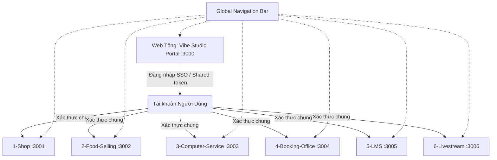

# 🌟 Vibe Studio - Hệ Sinh Thái Đa Nền Tảng (Hub & Sub-webs)

> Tài liệu đặc tả kiến trúc, danh mục các phân hệ, giải pháp kỹ thuật đồng bộ và hướng dẫn cấu hình cổng chạy giữa **Web Tổng (Portal)** và **6 Web Con chuyên biệt** trực thuộc công ty **Vibe Studio**.

---

## 📌 1. Giới Thiệu Tổng Quan (Overview)

* **Thương hiệu**: **Vibe Studio**
* **Mô hình kiến trúc**: **Hub & Spoke (Micro-Websites / Multi-Apps)**.
* **Web Tổng (Main Portal)**: Đóng vai trò là "cửa ngõ" trung tâm, hiển thị giao diện giới thiệu thương hiệu, khung **Đăng nhập / Đăng ký** người dùng và danh mục trực quan dẫn đến 6 phân hệ con.
* **Các Web Con (Sub-webs)**: 6 trang web hoạt động độc lập theo từng mảng nghiệp vụ chuyên sâu, được liên kết liền mạch với Web Tổng.

---

## 🏬 2. Danh Mục Các Phân Hệ & Bảng Cổng (Port) Đã Cấu Hình

Toàn bộ 7 dự án trên máy của bạn đã được thiết lập cổng độc lập, tránh xung đột:

| STT | Thư mục dự án | Phân hệ (Web Con) | Phong cách tham chiếu | Framework / Build Tool | Port Local (Đã cấu hình) |
| :--- | :--- | :--- | :--- | :--- | :--- |
| **00** | `Vibe portal/shadcn-landing-page` | **Vibe Studio Portal** | Trang chủ hệ sinh thái, Đăng nhập SSO | Vite + React + Tailwind | `http://localhost:3000` |
| **01** | `1-Shop/.../ShopeeClone` | **Vibe Shop** | Sàn TMĐT đa ngành hàng (Shopee) | Vite + React + TypeScript | `http://localhost:3001` |
| **02** | `2-Food-Selling/food-ecommerce-app` | **Vibe Farm / Food** | Đi chợ online, thực phẩm sạch (Sendo Farm) | Vite + React + Redux | `http://localhost:3002` |
| **03** | `3-Computer-Service/pc-builder` | **Vibe Tech / PC** | Linh kiện máy tính & Ráp PC (Phúc Anh) | Next.js 13 | `http://localhost:3003` |
| **04** | `4-Booking-Office/.../travel-agency` | **Vibe Travel** | Đặt vé máy bay & phòng khách sạn (Traveloka) | Next.js 14 + MongoDB | `http://localhost:3004` |
| **05** | `5-LMS/06-sub-hocmai` | **Vibe Edu** | Khóa học online & Video bài giảng (Hocmai) | Next.js 14 + Prisma | `http://localhost:3005` |
| **06** | `6-Livestream/04-sub-livestream` | **Vibe Live Studio** | Đặt phòng live & Studio livestream WebRTC | Next.js 14 + LiveKit | `http://localhost:3006` |

---

## 📂 3. Cấu Trúc Quản Lý Thư Mục Thực Tế Trên Máy

Cấu trúc thực tế tại `E:\Document\Web tổng\`:

```text
E:\Document\Web tổng\
│
├── README.md                                             # Tài liệu toàn bộ hệ thống
├── notebook 2.docx                                       # Ghi chú yêu cầu ban đầu
│
├── Vibe portal/
│   └── shadcn-landing-page/                              # [PORT 3000] Web Tổng Vibe Studio
│
├── 1-Shop/
│   └── Shopee-Clone-Reactjs/Shopee/ShopeeClone/          # [PORT 3001] Sàn TMĐT Shopee clone
│
├── 2-Food-Selling/
│   └── food-ecommerce-app/                               # [PORT 3002] Nông sản & Thực phẩm sạch
│
├── 3-Computer-Service/
│   └── pc-builder/                                       # [PORT 3003] Linh kiện PC & Ráp máy
│
├── 4-Booking-Office/
│   └── fullstack-nextjs-golobe-travel-agency/            # [PORT 3004] Du lịch & Vé Traveloka
│
├── 5-LMS/
│   └── 06-sub-hocmai/                                    # [PORT 3005] Khóa học online Hocmai
│
└── 6-Livestream/
    └── 04-sub-livestream/                                # [PORT 3006] Studio Livestream
```

---

## 🔌 4. Hướng Dẫn & Mẹo Đổi Cổng (Port Configuration Guide)

### ❓ Vì sao cần đổi cổng?
Mặc định, cả **Next.js** và các dự án dựng bằng **Vite** hay **Create-React-App** đều ưu tiên cổng mặc định `3000` hoặc `5173`. Khi bạn mở đồng thời 2-3 web để test tính năng chuyển trang, trình duyệt sẽ báo lỗi `Port is already in use` (cổng đang bận) hoặc tự động nhảy sang cổng ngẫu nhiên.

---

### 🛠️ Cách đổi cổng cho từng loại Framework:

#### 1. Dành cho dự án Next.js:
Trong file `package.json`, thêm cờ `-p <số_cổng>` vào lệnh `dev`:
```json
"scripts": {
  "dev": "next dev -p 3003"
}
```
> *(Nếu dự án dùng biến môi trường như `cross-env TZ=UTC next dev`, chỉ cần thêm `-p 3004` vào sau cùng: `cross-env TZ=UTC next dev -p 3004`)*.

#### 2. Dành cho dự án Vite (React / Vue):
Có 2 cách đổi (đã áp dụng cả 2 để đảm bảo độ chuẩn xác 100%):
* **Cách 1: Thêm cờ `--port <số_cổng>` vào `package.json`**:
  ```json
  "scripts": {
    "dev": "vite --port 3001"
  }
  ```
* **Cách 2: Cố định cổng trong file `vite.config.ts` hoặc `vite.config.js`**:
  ```ts
  export default defineConfig({
    server: {
      port: 3001,
      strictPort: true // Nếu cổng 3001 bận sẽ báo lỗi chứ không tự nhảy cổng khác
    }
  })
  ```

#### 3. Dành cho dự án React cũ (Create-React-App):
Nếu gặp template dùng `react-scripts start`:
* Thêm biến `PORT=xxxx` trước lệnh hoặc tạo file `.env`:
  ```text
  PORT=3001
  ```

---

### ✅ Trạng thái cấu hình trên máy của bạn (ĐÃ ĐỔI SẴN HOÀN TẤT):
* [x] **`Vibe portal`** ➔ Đã đổi thành `vite --port 3000`
* [x] **`1-Shop`** ➔ Đã đổi cả `package.json` (`--port 3001`) và `vite.config.ts` (`port: 3001`)
* [x] **`2-Food-Selling`** ➔ Đã đổi thành `vite --port 3002`
* [x] **`3-Computer-Service`** ➔ Đã đổi thành `next dev -p 3003`
* [x] **`4-Booking-Office`** ➔ Đã đổi thành `cross-env TZ=UTC next dev -p 3004`
* [x] **`5-LMS`** ➔ Đã đổi thành `next dev -p 3005`
* [x] **`6-Livestream`** ➔ Đã đổi thành `next dev -p 3006`

---

## 🔄 5. Giải Pháp Đồng Bộ Giữa Web Tổng Và Các Web Con



### 5.1. Đồng Bộ Đăng Nhập & Xác Thực (Single Sign-On - SSO)
1. **Môi trường Local (Phát triển):**
   * Khi người dùng đăng nhập tại Web Tổng, tạo một token người dùng (JWT giả lập hoặc Token Firebase).
   * Khi bấm vào từng Card dịch vụ chuyển sang Web con, truyền kèm param:
     `http://localhost:3001/?auth_token=VIBE_USER_TOKEN`
   * Web con đọc URL param này, lưu vào `localStorage` và chuyển trạng thái thành đã đăng nhập.
2. **Môi trường Online (Production Subdomain):**
   * Sử dụng Cookie chung domain (`domain: .vibestudio.vn`). Người dùng đăng nhập 1 lần tại `vibestudio.vn` là tự động đăng nhập trên `shop.vibestudio.vn`, `travel.vibestudio.vn`...

---

### 5.2. Đồng Bộ Giao Diện & Điều Hướng (Global Navigation Bar)
Nhúng thanh điều hướng mỏng ở đỉnh đầu của mỗi web con để người dùng luôn có đường quay về Web Tổng và chuyển nhanh sang các dịch vụ khác:

```html
<div class="vibe-global-bar">
  <div class="vibe-brand">
    <a href="http://localhost:3000/">
      
      <span>Vibe Studio</span>
    </a>
  </div>

  <nav class="vibe-quick-links">
    <a href="http://localhost:3000/">🏠 Trang Chủ</a>
    <a href="http://localhost:3001/">🛒 Shop</a>
    <a href="http://localhost:3002/">🥦 Nông Sản</a>
    <a href="http://localhost:3003/">💻 Ráp PC</a>
    <a href="http://localhost:3004/">✈️ Du Lịch</a>
    <a href="http://localhost:3005/">📚 Khóa Học</a>
    <a href="http://localhost:3006/">🎙️ Livestream</a>
  </nav>
</div>
```

---

## 🚀 6. Hướng Dẫn Bật Chạy Các Web Để Kiểm Tra

Bất cứ khi nào bạn muốn mở web nào, chỉ cần mở Terminal vào thư mục con tương ứng:

* **Chạy Web Tổng:**
  ```powershell
  cd "E:\Document\Web tổng\Vibe portal\shadcn-landing-page"
  npm install
  npm run dev
  # Mở tại: http://localhost:3000
  ```
* **Chạy Web Bán hàng (Shopee):**
  ```powershell
  cd "E:\Document\Web tổng\1-Shop\Shopee-Clone-Reactjs\Shopee\ShopeeClone"
  npm install
  npm run dev
  # Mở tại: http://localhost:3001
  ```
* **Chạy Web Ráp PC:**
  ```powershell
  cd "E:\Document\Web tổng\3-Computer-Service\pc-builder"
  npm install
  npm run dev
  # Mở tại: http://localhost:3003
  ```
